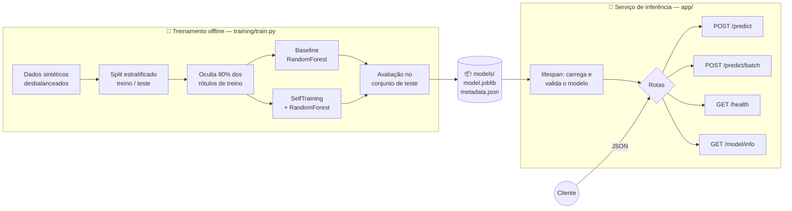
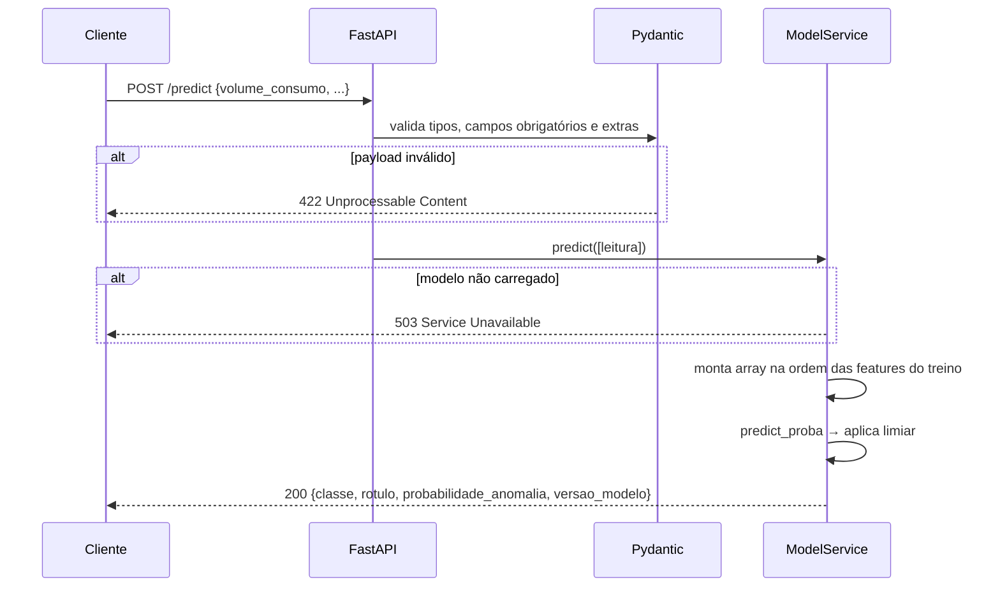

<div align="center">

# 🧠 ML Inference Service

**Microsserviço de detecção de anomalias de consumo com aprendizado semi-supervisionado, servido via FastAPI.**

[](https://github.com/MarieleV/scikit-learn-inference-service/actions/workflows/ci.yml)


[](https://github.com/astral-sh/ruff)
[](LICENSE)

[Sobre](#-sobre-o-projeto) •
[Arquitetura](#-arquitetura) •
[Como executar](#-como-executar) •
[API](#-endpoints) •
[Resultados](#-resultados-do-modelo) •
[Decisões técnicas](#-decisões-técnicas)

</div>

---

## 📌 Sobre o projeto

Empresas de saneamento precisam identificar **vazamentos e fraudes** a partir de leituras de hidrômetros. O problema é que **rotular** uma leitura como anômala exige inspeção em campo — cara e lenta — então só uma pequena fração dos dados tem rótulo.

Este projeto simula esse cenário e mostra o ciclo completo de levar um modelo para produção:

- 🧪 **Treinamento offline** com `SelfTrainingClassifier` (semi-supervisionado), que aproveita os dados **sem rótulo** via pseudo-rotulagem.
- 📊 **Avaliação honesta**: comparação contra um baseline supervisionado, com métricas adequadas a dados **desbalanceados** (F1, recall, ROC-AUC).
- 🚀 **Serviço de inferência** em FastAPI com validação de contrato, predição individual e em lote, health check e versionamento do modelo.
- ✅ **Engenharia**: testes automatizados, lint, Docker multi-stage e CI no GitHub Actions.

> [!NOTE]
> Os dados são **sintéticos** (`make_classification`, ~15% de anomalias). O foco é a arquitetura e as boas práticas de ML em produção, não o desempenho em um dataset real.

---

## 🏗 Arquitetura



<details>
<summary><b>Fluxo de uma requisição</b></summary>



</details>

### Estrutura do repositório

```
.
├── app/                     # Serviço de inferência
│   ├── main.py              # Application factory, rotas, lifespan, middleware
│   ├── model.py             # ModelService: carga, validação do contrato e inferência
│   ├── schemas.py           # Contratos de entrada/saída (Pydantic)
│   └── config.py            # Configuração por variáveis de ambiente
├── training/
│   ├── train.py             # Pipeline: dados → treino → avaliação → artefatos
│   └── experiment.py        # Experimento: self-training vs. baseline
├── tests/                   # Testes da API e do pipeline (pytest)
├── models/                  # Artefatos gerados (não versionados)
├── .github/workflows/ci.yml # Lint + testes + build e smoke test do Docker
├── Dockerfile               # Multi-stage: treina na build, imagem final enxuta
└── pyproject.toml           # Configuração do ruff e pytest
```

---

## ⚡ Como executar

### Com Docker (recomendado)

```bash
git clone https://github.com/MarieleV/scikit-learn-inference-service.git
cd scikit-learn-inference-service

docker build -t ml-inference-service .
docker run -p 8000:8000 ml-inference-service
```

O modelo é treinado durante o build, então a imagem já sobe pronta para uso.

### Localmente

<details open>
<summary><b>Passo a passo</b></summary>

```bash
# 1. Ambiente virtual
python -m venv .venv
source .venv/bin/activate        # Linux/macOS
.\.venv\Scripts\Activate.ps1     # Windows (PowerShell)

# 2. Dependências
pip install -r requirements-dev.txt

# 3. Treinar o modelo (gera models/model.joblib e models/metadata.json)
python -m training.train

# 4. Subir a API
uvicorn app.main:app --reload
```

</details>

Acesse a documentação interativa (Swagger) em **http://127.0.0.1:8000/docs**.

### Testes e qualidade

```bash
pytest -v                          # 23 testes: API, contrato e pipeline de treino
ruff check . && ruff format --check .
```

### Configuração

| Variável | Padrão | Descrição |
|---|---|---|
| `MODEL_DIR` | `models` | Diretório com `model.joblib` e `metadata.json` |
| `ANOMALY_THRESHOLD` | `0.5` | Probabilidade mínima para classificar como anomalia |
| `MAX_BATCH_SIZE` | `1000` | Máximo de leituras por requisição em lote |
| `LOG_LEVEL` | `INFO` | Nível de log |

---

## 🔌 Endpoints

| Método | Rota | Descrição |
|---|---|---|
| `POST` | `/predict` | Classifica uma leitura |
| `POST` | `/predict/batch` | Classifica várias leituras em uma única chamada ao modelo |
| `GET` | `/health` | Health check (`503` se o modelo não estiver carregado) |
| `GET` | `/model/info` | Versão, configuração de treino e métricas do modelo |

### Exemplo: predição individual

```bash
curl -X POST http://127.0.0.1:8000/predict \
  -H "Content-Type: application/json" \
  -d '{"volume_consumo": 1.25, "variacao_pressao": -0.40, "vazao_noturna": 2.10, "fator_sazonal": 0.30}'
```

```json
{
  "classe": 1,
  "rotulo": "anomalia",
  "probabilidade_anomalia": 0.76,
  "versao_modelo": "20261118173947"
}
```

<details>
<summary><b>Exemplo: predição em lote</b></summary>

```bash
curl -X POST http://127.0.0.1:8000/predict/batch \
  -H "Content-Type: application/json" \
  -d '{"leituras": [
        {"volume_consumo": 1.25, "variacao_pressao": -0.40, "vazao_noturna": 2.10, "fator_sazonal": 0.30},
        {"volume_consumo": -2.00, "variacao_pressao": 1.50, "vazao_noturna": -1.00, "fator_sazonal": 0.80}
      ]}'
```

```json
{
  "versao_modelo": "20261118173947",
  "total": 2,
  "total_anomalias": 1,
  "predicoes": [
    {"classe": 1, "rotulo": "anomalia", "probabilidade_anomalia": 0.76},
    {"classe": 0, "rotulo": "normal", "probabilidade_anomalia": 0.45}
  ]
}
```

</details>

<details>
<summary><b>Tratamento de erros</b></summary>

| Status | Quando |
|---|---|
| `422` | Tipo inválido, campo ausente, campo não previsto ou valor `NaN`/`Infinity` |
| `413` | Lote maior que `MAX_BATCH_SIZE` |
| `503` | Modelo não carregado (artefato ausente ou incompatível) |

</details>

Toda resposta inclui o header `X-Process-Time-Ms` com o tempo de processamento.

---

## 📊 Resultados do modelo

Conjunto de teste com 1.000 amostras (15% de anomalias), treino com **80% dos rótulos ocultos**:

| Modelo | Accuracy | Precision | Recall | F1 | ROC-AUC |
|---|---|---|---|---|---|
| Baseline (só dados rotulados) | 0.942 | 0.796 | **0.847** | 0.821 | **0.950** |
| **Self-training** (servido) | **0.944** | **0.814** | 0.834 | **0.824** | 0.944 |

As métricas ficam salvas em `models/metadata.json` e expostas em `GET /model/info`.

### O self-training realmente ajuda?

Para responder com mais rigor, `python -m training.experiment` varia a fração de rótulos ocultos (média de 3 seeds):

| % sem rótulo | F1 baseline | F1 self-training | ROC-AUC baseline | ROC-AUC self-training |
|---|---|---|---|---|
| 50% | 0.849 | 0.845 | 0.960 | 0.956 |
| 80% | 0.821 | 0.806 | 0.950 | 0.949 |
| 90% | 0.807 | 0.788 | 0.943 | 0.934 |
| 95% | 0.747 | 0.757 | 0.936 | 0.925 |
| 98% | 0.695 | 0.623 | 0.922 | 0.854 |

**Conclusão:** neste dataset, o self-training **empata** com o baseline e **piora** quando os rótulos são extremamente escassos (98%). Isso é coerente com a teoria:

- Métodos semi-supervisionados dependem da *hipótese de cluster* (pontos próximos tendem a ter a mesma classe). O `make_classification` não garante essa estrutura.
- Com pouquíssimos rótulos, o modelo inicial erra mais, e seus **pseudo-rótulos errados se propagam** (*confirmation bias*), principalmente na classe minoritária.

> [!TIP]
> Em um cenário real, eu manteria o pipeline que treina **os dois** modelos e só promoveria o self-training se ele superasse o baseline em um conjunto de validação. Por isso as duas métricas são registradas nos metadados.

---

## 🧭 Decisões técnicas

| Decisão | Motivo |
|---|---|
| **Treino separado da inferência** | A API nunca treina: carrega um artefato pronto no startup, sobe rápido e não consome CPU com treino. |
| **Metadados junto do modelo** | `metadata.json` registra versão, features, versão do scikit-learn e métricas — rastreabilidade de qual modelo respondeu cada requisição. |
| **Validação do contrato no startup** | Se as features do modelo divergem do schema da API, o serviço recusa o modelo em vez de responder previsões erradas silenciosamente. |
| **Rotas `def` em vez de `async def`** | A inferência é CPU-bound. Em `async def` ela bloquearia o event loop; com `def`, o FastAPI a executa em um threadpool. |
| **`n_jobs=1` no modelo servido** | Paralelismo acelera o treino, mas em inferência de uma linha o overhead de threads domina: **p50 caiu de ~29 ms para ~8,6 ms** (3,4× mais rápido). |
| **Probabilidade + limiar configurável** | Em detecção de anomalias o custo de falso negativo ≠ falso positivo. O limiar pode ser ajustado por variável de ambiente sem retreinar. |
| **Endpoint em lote vetorizado** | Uma chamada `predict_proba` para N linhas: 1.000 leituras em ~15 ms, contra ~8,6 s se fossem 1.000 requisições individuais. |
| **`class_weight="balanced"`** | Compensa o desbalanceamento (15% de anomalias) sem reamostrar os dados. |
| **Artefatos fora do Git** | Binários de modelo não são versionados; são reproduzíveis (`random_state` fixo) e gerados no build do Docker e no CI. |
| **Application factory (`create_app`)** | Permite que os testes criem a API com configurações diferentes (ex.: sem modelo, limite de lote menor). |
| **Docker multi-stage, usuário não-root** | A imagem final só contém o necessário para servir, roda sem privilégios e tem `HEALTHCHECK`. |

---

## 🗺 Próximos passos

- [ ] Promoção automática do modelo (*champion/challenger*) com conjunto de validação
- [ ] Calibração de probabilidades (`CalibratedClassifierCV`) e escolha do limiar pela curva precision-recall
- [ ] Monitoramento de *data drift* nas features recebidas
- [ ] Métricas Prometheus (latência, volume de predições, taxa de anomalias)
- [ ] Registro de modelos com MLflow

---

<div align="center">

Desenvolvido por **Mariele Vieira da Silva** · [GitHub](https://github.com/MarieleV)

</div>
