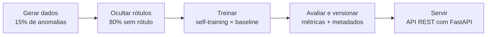
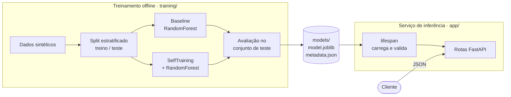
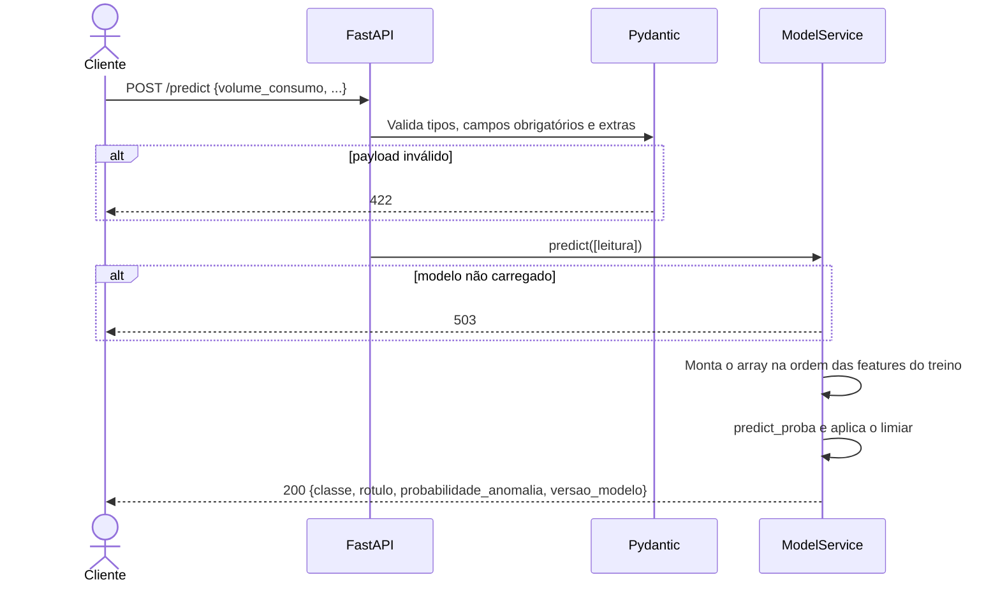
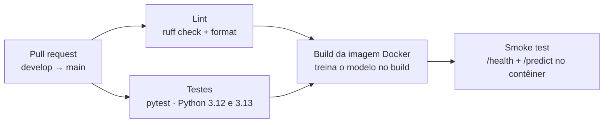

<div align="center">

# Serviço de Inferência de ML

**Detecta anomalias de consumo de água (vazamentos e fraudes) com um modelo semi-supervisionado<br/>treinado offline e servido por uma API REST com validação de contrato, versionamento e testes.**

<a href="#como-executar"></a>
<a href="#resultados-do-modelo"></a>
<a href="#decisões-técnicas"></a>

<a href="https://github.com/MarieleV/scikit-learn-inference-service/actions/workflows/ci.yml"></a>


<a href="./LICENSE"></a>

<sub>Machine Learning em produção · Engenharia de Software</sub>

</div>

---

## Visão geral

Empresas de saneamento precisam encontrar **vazamentos e fraudes** nas leituras de hidrômetros. O obstáculo é o rótulo: confirmar que uma leitura é anômala exige inspeção em campo, que é cara e lenta. Por isso, só uma pequena parte dos dados chega a ser rotulada.

Este projeto simula esse cenário e cobre o ciclo completo, do treino ao serviço em produção:



| | |
|---|---|
| **Semi-supervisionado** | `SelfTrainingClassifier` com RandomForest aproveita os dados sem rótulo por pseudo-rotulagem |
| **Avaliação honesta** | Comparação com um baseline supervisionado e métricas para dados desbalanceados (F1, recall, ROC-AUC) |
| **4 endpoints REST** | Predição individual e em lote, health check e metadados do modelo, com OpenAPI |
| **23 testes** | API, contrato entre modelo e API, e pipeline de treino (pytest) |
| **~8,6 ms por predição** | Latência p50 em uma linha; 1.000 leituras em lote em ~15 ms |

> [!NOTE]
> Os dados são **sintéticos** (`make_classification`). O foco é a arquitetura e as boas práticas de ML em produção, não o desempenho em um dataset real.

---

## Arquitetura



1. **Treino.** `training/train.py` gera dados desbalanceados, separa treino e teste de forma estratificada e oculta 80% dos rótulos de treino.
2. **Comparação.** O mesmo conjunto treina um baseline (só dados rotulados) e o self-training; os dois são avaliados no conjunto de teste.
3. **Artefatos.** O modelo vai para `model.joblib`; versão, features, versão do scikit-learn e métricas vão para `metadata.json`.
4. **Carga.** No startup, a API carrega o modelo **uma única vez** e confere se as features dele batem com o schema da API.
5. **Inferência.** O Pydantic valida o payload, o modelo calcula a probabilidade e o limiar configurável define a classe. A resposta informa a versão do modelo usada.

<details>
<summary><b>Sequência de uma predição</b></summary>
<br/>



</details>

---

## Resultados do modelo

Conjunto de teste com 1.000 amostras (15% de anomalias), treino com **80% dos rótulos ocultos**:

| Modelo | Accuracy | Precision | Recall | F1 | ROC-AUC |
|---|---|---|---|---|---|
| Baseline (só dados rotulados) | 0.942 | 0.796 | **0.847** | 0.821 | **0.950** |
| **Self-training** (servido) | **0.944** | **0.814** | 0.834 | **0.824** | 0.944 |

As métricas ficam em `models/metadata.json` e são expostas em `GET /model/info`.

<details open>
<summary><b>O self-training realmente ajuda?</b></summary>
<br/>

`python -m training.experiment` varia a fração de rótulos ocultos e calcula a média de 3 seeds:

| % sem rótulo | F1 baseline | F1 self-training | ROC-AUC baseline | ROC-AUC self-training |
|---|---|---|---|---|
| 50% | 0.849 | 0.845 | 0.960 | 0.956 |
| 80% | 0.821 | 0.806 | 0.950 | 0.949 |
| 90% | 0.807 | 0.788 | 0.943 | 0.934 |
| 95% | 0.747 | 0.757 | 0.936 | 0.925 |
| 98% | 0.695 | 0.623 | 0.922 | 0.854 |

**Conclusão:** neste dataset, o self-training **empata** com o baseline e **piora** quando os rótulos são extremamente escassos (98%). Isso é coerente com a teoria:

- Métodos semi-supervisionados dependem da *hipótese de cluster* (pontos próximos tendem a ter a mesma classe), e o `make_classification` não garante essa estrutura.
- Com pouquíssimos rótulos, o modelo inicial erra mais, e os **pseudo-rótulos errados se propagam** (*confirmation bias*), principalmente na classe minoritária.

</details>

> [!TIP]
> Em um cenário real, o pipeline treinaria os dois modelos e só promoveria o self-training se ele superasse o baseline em um conjunto de validação. Por isso as duas métricas ficam registradas nos metadados.

---

## Decisões técnicas

As escolhas abaixo são as que mais influenciaram o serviço. Cada uma tem uma alternativa mais simples que foi descartada de propósito.

<details open>
<summary><b>Treino separado da inferência, com metadados junto do modelo</b></summary>

- **Decisão:** o treino roda em um script próprio e gera dois artefatos: o modelo e um `metadata.json` com versão, features, versão do scikit-learn e métricas. A API só carrega.
- **Por quê:** a API sobe rápido, não gasta CPU treinando e sabe exatamente qual modelo respondeu cada requisição (`versao_modelo` vai em toda resposta).
- **Consequência assumida:** os artefatos não são versionados no Git. Eles são reproduzíveis (`random_state` fixo) e gerados no build do Docker e no CI.

</details>

<details>
<summary><b>Validação do contrato entre modelo e API no startup</b></summary>

- **Decisão:** ao carregar, a API compara as features registradas no modelo com os campos do schema Pydantic e recusa o modelo se forem diferentes. O array de entrada é montado na ordem gravada no treino.
- **Por quê:** o scikit-learn recebe um array sem nomes de coluna. Uma feature trocada de lugar geraria previsões erradas **sem nenhum erro**. É melhor o serviço ficar indisponível (503) do que responder errado.

</details>

<details>
<summary><b>Rotas <code>def</code> em vez de <code>async def</code></b></summary>

- **Decisão:** as rotas de predição são funções síncronas.
- **Por quê:** a inferência é CPU-bound. Dentro de `async def`, ela bloquearia o event loop e travaria todas as outras requisições; com `def`, o FastAPI a executa em um threadpool.

</details>

<details>
<summary><b><code>n_jobs=1</code> no modelo servido</b></summary>

- **Decisão:** a RandomForest treina com todos os núcleos (`n_jobs=-1`), mas é salva com `n_jobs=1`.
- **Por quê:** em uma predição de uma linha, o custo de coordenar threads supera o ganho. Medido: **p50 caiu de ~29 ms para ~8,6 ms** (3,4× mais rápido). O paralelismo fica a cargo da API, que atende várias requisições ao mesmo tempo.

</details>

<details>
<summary><b>Probabilidade e limiar configurável, em vez de só a classe</b></summary>

- **Decisão:** a resposta traz `probabilidade_anomalia`, e a classe sai de um limiar definido por `ANOMALY_THRESHOLD`.
- **Por quê:** em detecção de anomalias, deixar passar um vazamento custa diferente de inspecionar um alarme falso. O limiar pode ser ajustado sem retreinar o modelo.

</details>

<details>
<summary><b>Endpoint em lote vetorizado</b></summary>

- **Decisão:** `/predict/batch` faz uma única chamada a `predict_proba` para todas as leituras, com limite configurável (`MAX_BATCH_SIZE`, resposta 413 acima dele).
- **Por quê:** 1.000 leituras em lote levam ~15 ms; como 1.000 requisições individuais, só a inferência somaria ~8,6 s.

</details>

<details>
<summary><b>Dados desbalanceados tratados no modelo e nas métricas</b></summary>

- **Decisão:** `class_weight="balanced"`, split estratificado e métricas focadas na classe positiva.
- **Por quê:** com 15% de anomalias, um modelo que responde sempre "normal" tem 85% de acurácia e não serve para nada. F1, recall e ROC-AUC mostram se as anomalias estão sendo encontradas.

</details>

---

## Endpoints

| Método | Rota | O que faz |
|---|---|---|
| `POST` | `/predict` | Classifica uma leitura |
| `POST` | `/predict/batch` | Classifica várias leituras em uma única chamada ao modelo |
| `GET` | `/health` | Health check; responde `503` se o modelo não estiver carregado |
| `GET` | `/model/info` | Versão, configuração de treino e métricas do modelo |

**Requisição:**

```bash
curl -X POST http://127.0.0.1:8000/predict \
  -H "Content-Type: application/json" \
  -d '{"volume_consumo": 1.25, "variacao_pressao": -0.40, "vazao_noturna": 2.10, "fator_sazonal": 0.30}'
```

**Resposta:**

```json
{
  "classe": 1,
  "rotulo": "anomalia",
  "probabilidade_anomalia": 0.76,
  "versao_modelo": "20261118173947"
}
```

<details>
<summary><b>Predição em lote</b></summary>
<br/>

```bash
curl -X POST http://127.0.0.1:8000/predict/batch \
  -H "Content-Type: application/json" \
  -d '{"leituras": [
        {"volume_consumo": 1.25, "variacao_pressao": -0.40, "vazao_noturna": 2.10, "fator_sazonal": 0.30},
        {"volume_consumo": -2.00, "variacao_pressao": 1.50, "vazao_noturna": -1.00, "fator_sazonal": 0.80}
      ]}'
```

```json
{
  "versao_modelo": "20261118173947",
  "total": 2,
  "total_anomalias": 1,
  "predicoes": [
    {"classe": 1, "rotulo": "anomalia", "probabilidade_anomalia": 0.76},
    {"classe": 0, "rotulo": "normal", "probabilidade_anomalia": 0.45}
  ]
}
```

</details>

<details>
<summary><b>Respostas de erro</b></summary>
<br/>

| Status | Quando |
|---|---|
| `422` | Tipo inválido, campo ausente, campo não previsto ou valor `NaN`/`Infinity` |
| `413` | Lote maior que `MAX_BATCH_SIZE` |
| `503` | Modelo não carregado (artefato ausente ou incompatível com a API) |

</details>

Toda resposta inclui o header `X-Process-Time-Ms` com o tempo de processamento.

---

## Qualidade e entrega contínua



- **CI no GitHub Actions:** lint, testes em duas versões do Python, build da imagem e teste do contêiner rodando de verdade.
- **Testes de contrato:** além das rotas, os testes garantem que as features do treino batem com o schema da API e que um modelo incompatível é recusado.
- **Docker multi-stage:** o primeiro estágio treina o modelo; a imagem final só tem o necessário para servir, roda com usuário sem privilégios e tem `HEALTHCHECK`.
- **Fluxo de trabalho:** git-flow (`feature/*` → `develop` → PR para `main`).

---

## Stack

| Camada | Tecnologias |
|---|---|
| **Machine Learning** |    |
| **API** |     |
| **Infraestrutura** |   |
| **Qualidade** |   |

---

## Como executar

**Pré-requisitos:** Docker Desktop **ou** Python 3.12+, e Git.

**Com Docker** (o modelo é treinado durante o build):

```bash
git clone https://github.com/MarieleV/scikit-learn-inference-service.git
cd scikit-learn-inference-service
docker build -t ml-inference-service .
docker run -p 8000:8000 ml-inference-service
```

**Localmente:**

```bash
python -m venv .venv
source .venv/bin/activate          # PowerShell: .\.venv\Scripts\Activate.ps1
pip install -r requirements-dev.txt
python -m training.train           # gera models/model.joblib e models/metadata.json
uvicorn app.main:app --reload
```

| Serviço | Endereço |
|---|---|
| API | <http://localhost:8000> |
| Documentação interativa (Swagger) | <http://localhost:8000/docs> |
| Saúde do serviço | <http://localhost:8000/health> |

<details>
<summary><b>Testes, lint e experimento</b></summary>
<br/>

```bash
pytest -v                               # 23 testes
ruff check . && ruff format --check .   # lint e formatação, igual ao CI
python -m training.experiment           # self-training × baseline por % de rótulos
```

</details>

<details>
<summary><b>Variáveis de ambiente</b></summary>
<br/>

| Variável | Padrão | Descrição |
|---|---|---|
| `MODEL_DIR` | `models` | Pasta com `model.joblib` e `metadata.json` |
| `ANOMALY_THRESHOLD` | `0.5` | Probabilidade mínima para classificar como anomalia |
| `MAX_BATCH_SIZE` | `1000` | Máximo de leituras por requisição em lote |
| `LOG_LEVEL` | `INFO` | Nível de log |

</details>

---

## Estrutura do repositório

```text
scikit-learn-inference-service/
├── app/               API FastAPI: rotas, carga do modelo, schemas e configuração
├── training/          Pipeline de treino e experimento self-training × baseline
├── tests/             Testes da API, do contrato e do treino (pytest)
├── models/            Artefatos gerados pelo treino (não versionados)
├── .github/workflows/ Pipeline de CI
├── Dockerfile         Build multi-stage: treina e serve
└── pyproject.toml     Configuração do ruff e do pytest
```

---

## Roadmap

- [x] Pipeline de treino com baseline, métricas e metadados
- [x] API com predição individual e em lote, health check e versionamento
- [x] Testes, lint, Docker e CI
- [ ] Promoção automática do modelo (*champion/challenger*) com conjunto de validação
- [ ] Calibração de probabilidades e escolha do limiar pela curva precision-recall
- [ ] Monitoramento de *data drift* nas features recebidas
- [ ] Métricas Prometheus (latência, volume e taxa de anomalias)
- [ ] Registro de modelos com MLflow

---

<div align="center">

**Mariele Vieira da Silva**<br/>
<sub>Engenharia de Software · Católica SC</sub>

<a href="https://www.linkedin.com/in/mariele-vieira"></a>
<a href="https://github.com/MarieleV"></a>
<a href="mailto:silvamariele797@gmail.com"></a>

</div>
